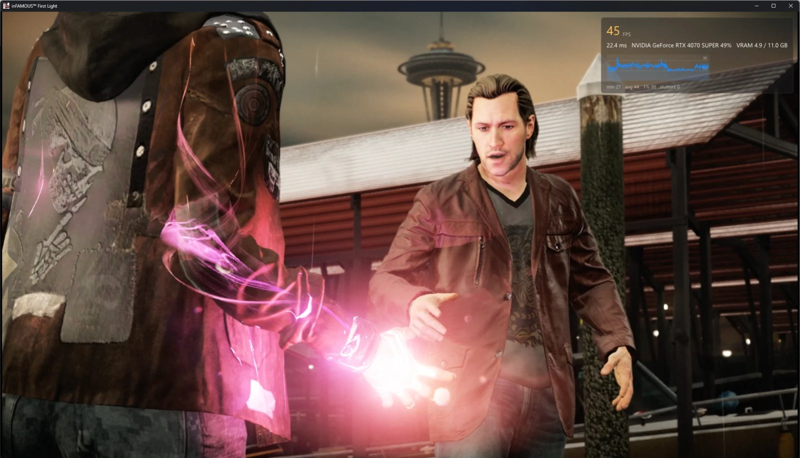
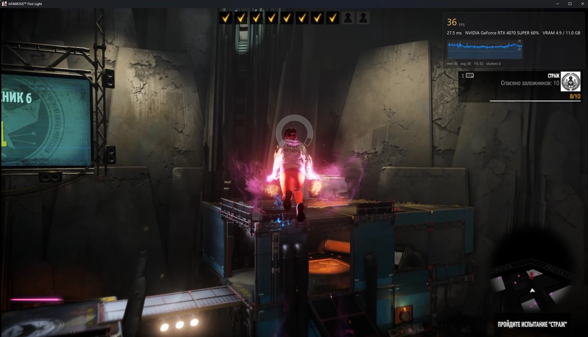

# inFAMOUS First Light — native PC port

An unofficial native Windows port of **inFAMOUS First Light** (PS4). The game's own x86-64 code runs directly on the PC's processor, a reimplemented PS4 runtime stands in for the console's system libraries, and the graphics are translated to Vulkan. It is not a general-purpose emulator.

> **You need your own copy of the game**, dumped from your own PS4. No game files, firmware, keys or Sony assets are part of this repository or its releases.

[Русская версия ниже](#русский)

| | |
|---|---|
|  |  |


<sub>Ryzen + RTX 4070 SUPER, 1080p. The launcher shows the art of the player's own game files.</sub>

## Status

**Early, playable.** The game boots, reaches the menus and gameplay, saves, and plays through the first missions; Fetch's neon powers, the dash trail, lights and particles render.

| | |
|---|---|
| Tested dump | CUSA00897 (EU), base game 1.00 |
| Frame rate | about 25–30 FPS on a Ryzen + RTX 4070 SUPER; first goal: a steady 30 FPS on mid-range PCs |
| Known issues | GPU readbacks cost frame rate (work in progress); some lights pulse in the boat cutscene |

## Playing

1. Download a release (when there is one) and unzip it anywhere.
2. Start **inFAMOUS First Light.exe** and pick your game folder (the one with `eboot.bin` and `sce_sys`).
3. Press **Play**. F10 shows the performance overlay; Insert (or R3 + L2) opens the in-game menu.

Requirements: Windows 10/11 64-bit, a Vulkan 1.3 GPU, a CPU with AVX (Intel CPUs work: the AMD-only instructions the game uses are emulated).

**Dumping your game:** on your own PS4 with GoldHEN, dump the game (and its update, if any) with a homebrew dumper such as Itemzflow, and copy the folder to the PC.

### Controls

Xbox, PlayStation and other controllers work, and so does the keyboard. The touchpad and the motion sensor are simulated on controllers without them:

| In game | Xbox / other controller | Keyboard |
|---|---|---|
| Press the touchpad | View | Tab / Backspace |
| Touchpad swipe | hold View + right stick | hold Tab + arrows |
| Graffiti: controller on its side | L3 + R3 (sensor mode on/off) | hold T or G |
| Graffiti: shake / spray / aim | A / R2 / left stick | Y / F / arrows |

## Reporting performance

Test builds carry a `TEST_BUILD` file: they log detailed performance statistics. After playing, open **Log → Create report** in the launcher and send the zip (logs and the PC's specs, no personal paths). Reports from many different PCs are what the optimisation needs.

## Building

In an **MSYS2 CLANG64** shell:

```bash
pacman -S --needed git patch \
  mingw-w64-clang-x86_64-{toolchain,cmake,ninja,pkgconf,python} \
  mingw-w64-clang-x86_64-{vulkan-headers,vulkan-loader,vulkan-memory-allocator,glslang} \
  mingw-w64-clang-x86_64-{sdl3,fmt,boost,robin-map,xxhash,ffmpeg,zydis} \
  mingw-w64-clang-x86_64-{spirv-tools,spirv-headers,spirv-cross}
git clone --recursive <this repository> && cd <repository>
cd port && ISS_LTO=OFF bash build.sh && cd ..
```

The launcher (PySide6): `py -m venv .venv`, `.venv\Scripts\pip install PySide6-Essentials pillow iced-x86`, then `launcher\start.bat`. A release folder: `bash dev/package.sh` (`TEST=1` for a test build). `bash dev/export_public.sh` shows exactly what a push publishes.

| Folder | What it holds |
|---|---|
| `port/` | The core: loader, PS4 runtime (`src/`), Vulkan renderer (`gpu/`), game preparation scripts |
| `launcher/` | The launcher (PySide6 + Qt Quick) |
| `dev/` | Packaging, RenderDoc capture, debugging aids |
| `docs/iss_pc/` | The documentation of the project the core comes from |

## Credits and license

This port is a fork of [**iss_pc**](https://github.com/HayatoG/iss_pc) by **HayatoG**, the native PC port of inFAMOUS Second Son; its core (runtime, loader, GPU translation and many fixes) is the foundation of this project. The GPU translation comes from [**shadPS4**](https://github.com/shadps4-emu/shadPS4); iss_pc also credits [tlg_pc](https://github.com/HayatoG/tlg_pc), [gr2_pc](https://github.com/HayatoG/gr2_pc), [gow3_pc](https://github.com/FelipePrado0/gow3_pc), [bloodborne_pc](https://github.com/deadinside28/bloodborne_pc), [ShadowOfTheColossus-PC](https://github.com/AjncSystem/ShadowOfTheColossus-PC) and the other projects listed in [docs/iss_pc](docs/iss_pc/README.md). ATRAC9 audio via [LibAtrac9](https://github.com/Thealexbarney/LibAtrac9).

Licensed under **GPL-2.0**, like the projects it builds on ([LICENSE](LICENSE)).

*inFAMOUS* is a trademark of Sony Interactive Entertainment. This project is not affiliated with Sony Interactive Entertainment or Sucker Punch Productions.

---

<a id="русский"></a>

# inFAMOUS First Light — нативный порт на ПК

Неофициальный нативный порт **inFAMOUS First Light** (PS4) на Windows. Собственный x86-64 код игры выполняется прямо на процессоре ПК, системные библиотеки консоли заменены переписанной средой выполнения, а графика переводится на Vulkan. Это не универсальный эмулятор.

> **Нужна ваша собственная копия игры**, снятая с вашей PS4. Ни файлов игры, ни прошивки, ни ключей, ни материалов Sony в репозитории и релизах нет.

Скриншоты — [в начале страницы](#infamous-first-light--native-pc-port): неоновая сила Проныры в катсцене, испытание на арене с оверлеем производительности и лаунчер.

## Состояние

**Ранняя версия, игра проходится.** Игра запускается, доходит до меню и геймплея, сохраняется, проходятся первые миссии. Неоновые способности Проныры, след рывка, свет и частицы отображаются.

| | |
|---|---|
| Проверенный дамп | CUSA00897 (EU), базовая игра 1.00 |
| FPS | около 25–30 на Ryzen + RTX 4070 SUPER; первая цель — стабильные 30 FPS на средних ПК |
| Известные проблемы | чтение данных с видеокарты стоит FPS (в работе); в катсцене с лодкой мигают некоторые огни |

## Как играть

1. Скачайте релиз (когда он появится) и распакуйте куда угодно.
2. Запустите **inFAMOUS First Light.exe** и выберите папку с игрой (в ней `eboot.bin` и `sce_sys`).
3. Нажмите **«Играть»**. F10 показывает оверлей производительности, Insert (или R3 + L2) открывает меню в игре.

Нужно: Windows 10/11 64-бит, видеокарта с Vulkan 1.3, процессор с AVX (процессоры Intel тоже подходят: инструкции AMD, которые использует игра, эмулируются).

**Как снять дамп:** на своей PS4 с GoldHEN снимите игру (и обновление, если есть) homebrew-дампером, например Itemzflow, и скопируйте папку на ПК.

### Управление

Работают геймпады Xbox, PlayStation и другие, а также клавиатура. Тачпад и датчик движения эмулируются на геймпадах без них:

| В игре | Xbox / другой геймпад | Клавиатура |
|---|---|---|
| Нажать тачпад | View | Tab / Backspace |
| Свайп по тачпаду | зажать View + правый стик | зажать Tab + стрелки |
| Граффити: геймпад на боку | L3 + R3 (режим датчика вкл/выкл) | зажать T или G |
| Граффити: встряхнуть / распылять / целиться | A / R2 / левый стик | Y / F / стрелки |

## Отчёты о производительности

В тестовых сборках лежит файл `TEST_BUILD`: они пишут подробную статистику производительности. После игры откройте в лаунчере **«Журнал» → «Собрать отчёт»** и пришлите архив (логи и характеристики ПК, без личных путей). Для оптимизации нужны отчёты с как можно большего числа разных ПК.

## Сборка из исходников

Шаги выше, в разделе [Building](#building): MSYS2 CLANG64, `bash build.sh` в `port/`, лаунчер через `launcher\start.bat`, пакет через `bash dev/package.sh`.

## Авторы и лицензия

Этот порт — форк [**iss_pc**](https://github.com/HayatoG/iss_pc) от **HayatoG**, нативного порта inFAMOUS Second Son; его ядро (среда выполнения, загрузчик, перевод графики и множество исправлений) — основа этого проекта. Перевод графики взят из [**shadPS4**](https://github.com/shadps4-emu/shadPS4); остальные проекты, на которых построен iss_pc, перечислены в [docs/iss_pc](docs/iss_pc/README.md).

Лицензия **GPL-2.0**, как у проектов, на которых он основан ([LICENSE](LICENSE)).

*inFAMOUS* — товарный знак Sony Interactive Entertainment. Проект не связан с Sony Interactive Entertainment и Sucker Punch Productions.
